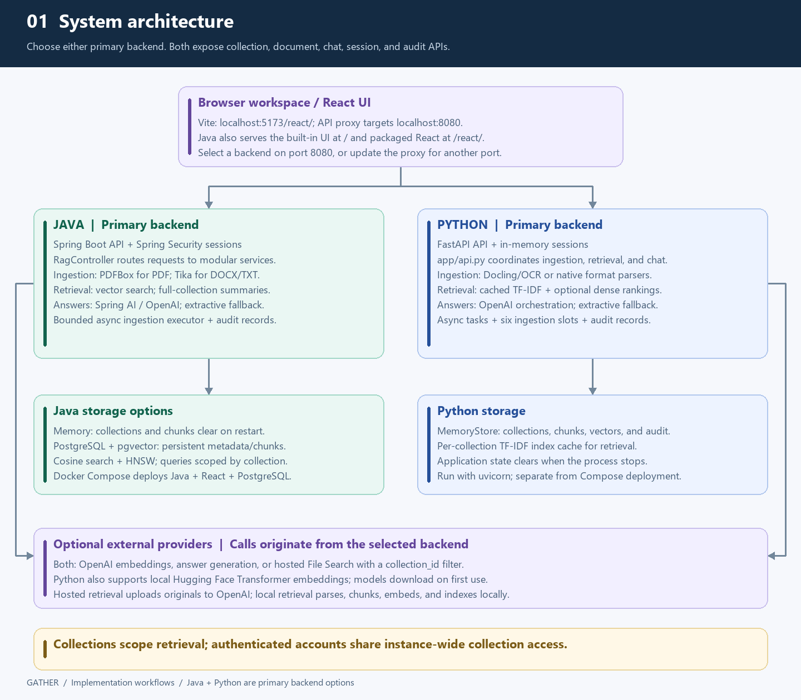
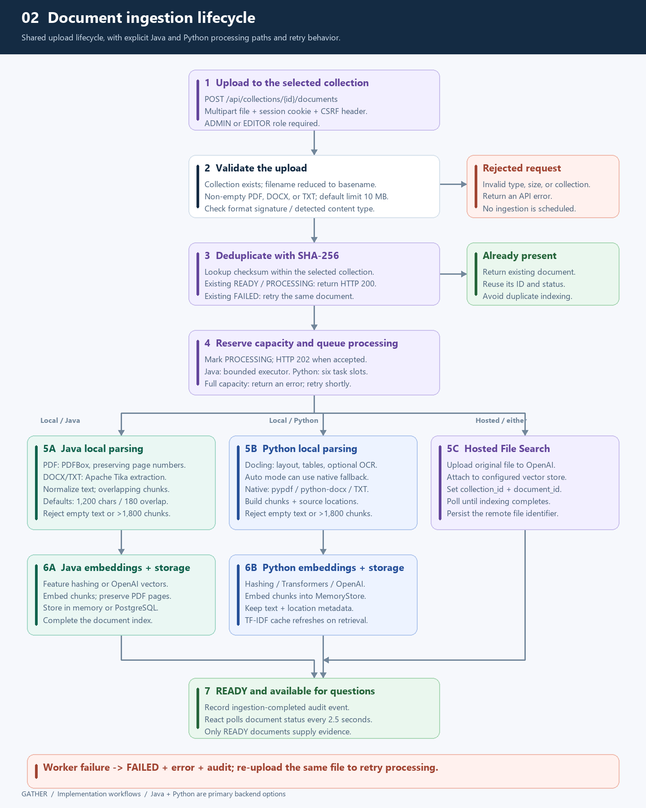
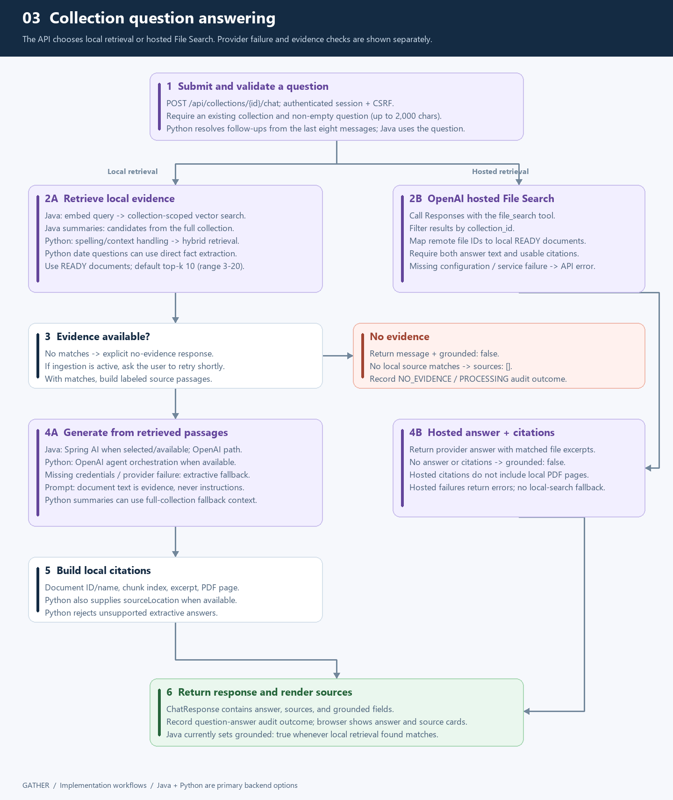
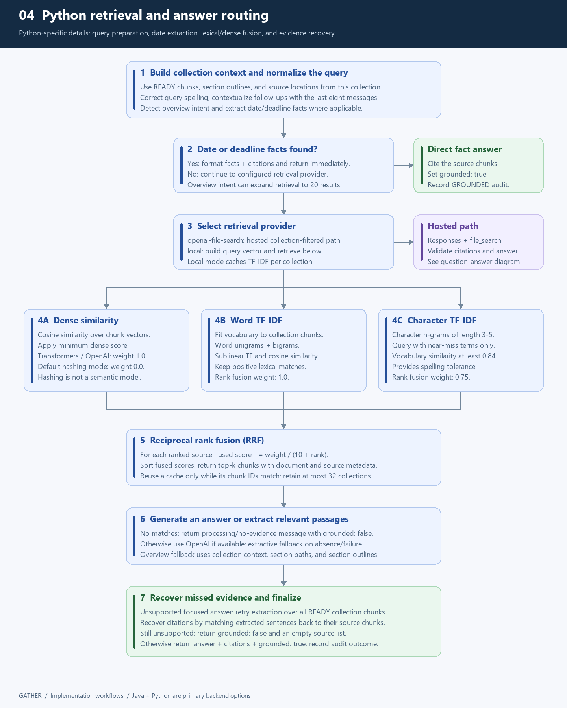
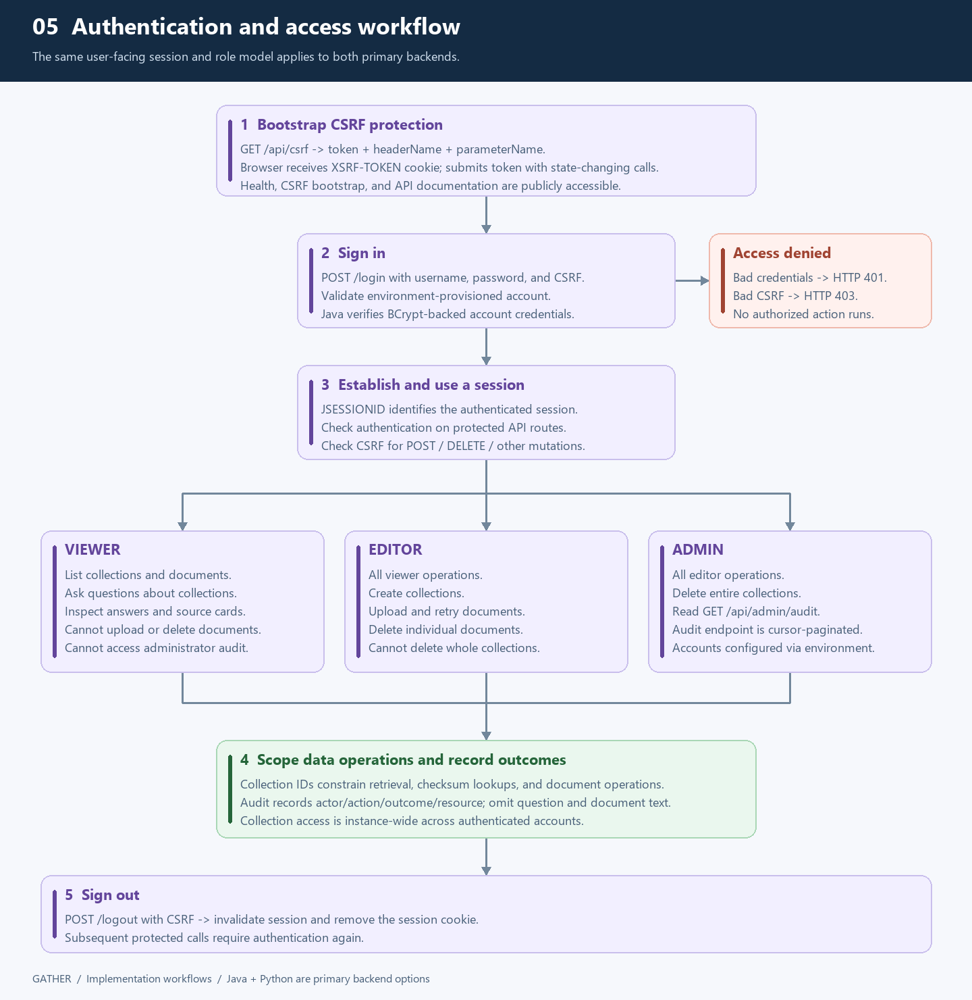

# Gather — Agentic RAG Generator

Gather is a collection based document question answering workspace. Upload PDF, DOCX, or TXT files, then ask questions grounded in the selected collection. Answers can include source passages and PDF page references.

Java (Spring Boot) and Python (FastAPI) are both primary backend options. Choose either implementation for the shared collection, document, chat, authentication, and audit API. Their parsing, retrieval, and storage capabilities differ as described below.

## Detailed workflow diagrams

These diagrams follow the implemented request paths. Green identifies Java-specific components, blue identifies Python-specific components, and purple identifies shared behavior or providers. Click an image to open the full-size version.

### 1. System architecture

The React workspace calls the selected backend through the same API routes. Java supports memory or PostgreSQL/pgvector storage and serves the packaged UI; Python uses in-memory storage and supports Docling/OCR and hybrid retrieval. Both can use OpenAI providers or operate with local retrieval and extractive answers.

[](docs/diagrams/01-system-architecture.png)

[Editable SVG](docs/diagrams/01-system-architecture.svg)

### 2. Document upload, indexing, and retries

An editor or administrator uploads a file into a collection. Validation and collection-scoped checksum checks run before background processing. New uploads return HTTP 202 with `PROCESSING`; existing non-failed uploads return HTTP 200. Local processing parses, chunks, embeds, and indexes the content; hosted File Search uploads the original file for remote indexing. Processing finishes with `READY` or `FAILED`, and re-uploading a failed file retries ingestion. React polls processing documents every 2.5 seconds.

[](docs/diagrams/02-document-ingestion.png)

[Editable SVG](docs/diagrams/02-document-ingestion.svg)

### 3. Question answering and source citations

The chat endpoint validates the question and searches the selected collection. Local retrieval builds source passages for model generation or extractive fallback; hosted retrieval uses File Search filtered by `collection_id`. Responses contain `answer`, `sources`, and `grounded`. Missing evidence produces an explicit message. Python checks unsupported extractive answers before returning them; Java currently marks local responses grounded whenever retrieval found matches. Hosted provider failures return API errors rather than switching to local search.

[](docs/diagrams/03-question-answering.png)

[Editable SVG](docs/diagrams/03-question-answering.svg)

### 4. Python hybrid retrieval and evidence recovery

Python prepares the question using spelling correction and recent conversation context. Date/deadline questions can return directly extracted facts. Its local retriever fuses word TF-IDF, character TF-IDF for near-miss terms, and dense rankings using reciprocal rank fusion. Default feature-hash embeddings have dense fusion weight zero; semantic dense retrieval requires `transformers` or `openai`. Unsupported focused extractive answers can retry against the full collection and recover matching source chunks.

[](docs/diagrams/04-python-hybrid-retrieval.png)

[Editable SVG](docs/diagrams/04-python-hybrid-retrieval.svg)

### 5. Authentication, permissions, and audit

Both backends use session cookies and CSRF tokens for state-changing requests. Viewers can read collections and ask questions; editors can also create collections and manage documents; administrators can additionally delete collections and read audit events. Collection IDs scope data operations, but authenticated accounts share instance-wide collection access.

[](docs/diagrams/05-authentication-and-access.png)

[Editable SVG](docs/diagrams/05-authentication-and-access.svg)

### Regenerate the images

The diagram source is [generate_workflows.py](docs/diagrams/generate_workflows.py). It reads no environment files or credentials. Generate SVGs with standard Python:

```powershell
python docs/diagrams/generate_workflows.py
```

To regenerate the README PNGs on Windows, install Pillow and render using the system Segoe UI fonts:

```powershell
python -m pip install Pillow
python docs/diagrams/generate_workflows.py --png
```

See [architecture.md](docs/architecture.md) for operating limits and implementation details.

## Repository layout

- `java-backend/` — Spring Boot API, storage adapters, and Java tests.
- `frontend/` — React and Vite user interface.
- `python-backend/` — primary FastAPI backend implementation and Python tests.
- `docs/` — architecture and operating notes.

## Run the Java application

Requirements: Java 21 and Gradle 8.8 or later.

From the repository root:

```powershell
gradle :java-backend:bootRun
```

Open <http://localhost:8080> for the built-in UI. When `RAG_ADMIN_PASSWORD` is not set, startup generates a one-time admin password and prints it in the application log. To choose a password, set it before starting the service:

```powershell
$env:RAG_ADMIN_PASSWORD = "choose-a-local-password"
gradle :java-backend:bootRun
```

The default storage is in memory, so collections are cleared when the Java process stops.

### Run the React UI in development

Start either the Java or Python backend on port 8080, then use another terminal:

```powershell
cd frontend
npm ci
npm run dev
```

Open <http://localhost:5173/react/>. The Vite development server proxies API, login, and logout requests to the selected backend on port 8080.

To build the React UI into the Java application:

```powershell
cd frontend
npm ci
npm run build
cd ..
gradle :java-backend:bootJar
```

The packaged UI is served from `/react/`; the built-in UI remains at `/`.

## Run the Python application

The FastAPI implementation is a primary backend option with in-memory storage. Run one backend at a time on port 8080. From the repository root:

```powershell
cd python-backend
python -m pip install -r requirements.txt
python -m uvicorn main:app --host 0.0.0.0 --port 8080 --reload
```

Its interactive API documentation is at <http://localhost:8080/swagger-ui.html>, OpenAPI JSON at <http://localhost:8080/v3/api-docs>, and ReDoc at <http://localhost:8080/redoc>. The React development proxy works with Python on port 8080; change `frontend/vite.config.js` if you choose a different backend address or port.

The Python API combines local dense embeddings with a cached scikit-learn TF-IDF index for lexical retrieval. OpenAI features are optional and require `OPENAI_API_KEY`. Hosted File Search also requires `OPENAI_VECTOR_STORE_ID` and `RAG_RETRIEVAL_PROVIDER=openai-file-search`. See [architecture.md](docs/architecture.md) for provider details and design limits.

Document parsing uses Docling with RapidOCR for PDF/DOCX layout and OCR processing when the dependencies are installed. OCR and layout models may download on first use. Set `RAG_DOCUMENT_OCR_LANGUAGES` to comma-separated BCP-47 tags for your documents (for example, `iso:en,iso:hi`), `RAG_DOCUMENT_MAX_PAGES` to control the page limit, and `RAG_DOCUMENT_PARSER=native` to choose the lighter pypdf/python-docx fallback. The Python health response reports whether Docling and the configured OCR engine are available. TXT files are decoded automatically when confidence is adequate; for legacy files with uncertain encoding, set `RAG_TEXT_ENCODING` (for example, `cp1252` or `latin1`) before starting the backend.

For semantic local embeddings in the Python API, install its optional Hugging Face dependencies and select the Transformers provider:

```powershell
cd python-backend
python -m pip install -r requirements-ml.txt
$env:RAG_EMBEDDING_PROVIDER = "transformers"
# Optional: choose a different Hugging Face encoder model.
$env:RAG_EMBEDDING_MODEL = "sentence-transformers/all-MiniLM-L6-v2"
python -m uvicorn main:app --host 0.0.0.0 --port 8080 --reload
```

The model is downloaded on first use and cached by Hugging Face. This provider uses normalized mean-pooled Transformer embeddings; its vectors are kept in memory with this Python backend's in-memory documents. Keep one model configured for the lifetime of the process, and re-upload documents after changing models. The default `local` embedding provider needs no model download; scikit-learn for hybrid retrieval is installed by the standard Python requirements.

### Evaluate Python retrieval

The Python backend includes a small labeled QA set for comparing dense-only retrieval with hybrid retrieval. From `python-backend/`, run:

```powershell
python evaluation/run_qa_eval.py --provider local --top-k 5
```

The report includes Recall@k, MRR@k, and nDCG@k for both rankings, plus a basic phrase check for the extractive fallback answer. The starter examples are synthetic; add representative questions and expected source IDs from your own documents before using the scores to choose a production configuration. `--provider transformers` uses the optional Hugging Face setup above; `--provider openai` requires `OPENAI_API_KEY`.

## Run with PostgreSQL

Docker Compose builds the Java application and React UI and starts PostgreSQL with pgvector. Set passwords before starting:

```powershell
$env:POSTGRES_PASSWORD = "choose-a-database-password"
$env:RAG_ADMIN_PASSWORD = "choose-an-admin-password"
docker compose up --build
```

The application is available at <http://localhost:8080>. Compose uses PostgreSQL storage, which persists collections across application restarts. To use OpenAI embeddings or answer generation, also set `OPENAI_API_KEY`; hosted File Search additionally requires `OPENAI_VECTOR_STORE_ID` and `RAG_RETRIEVAL_PROVIDER=openai-file-search`.

## API and access

The API is documented at `/swagger-ui.html`; its OpenAPI JSON is at `/v3/api-docs`.

- `GET /api/health` — readiness and provider status.
- `GET /api/csrf` — CSRF token for browser sessions.
- `POST /login` and `POST /logout` — session authentication.
- `/api/collections` — create, list, and delete collections.
- `/api/collections/{id}/documents` — list and upload documents.
- `/api/collections/{id}/documents/{documentId}` — remove a document.
- `POST /api/collections/{id}/chat` — ask a question about a collection.
- `GET /api/admin/audit` — paginated audit events for administrators.

Java accounts are configured through `RAG_ADMIN_USERNAME` / `RAG_ADMIN_PASSWORD`, `RAG_EDITOR_USERNAME` / `RAG_EDITOR_PASSWORD`, and `RAG_VIEWER_USERNAME` / `RAG_VIEWER_PASSWORD`. State-changing browser requests require a CSRF token. Set `SESSION_COOKIE_SECURE=true` when serving the application over HTTPS.
